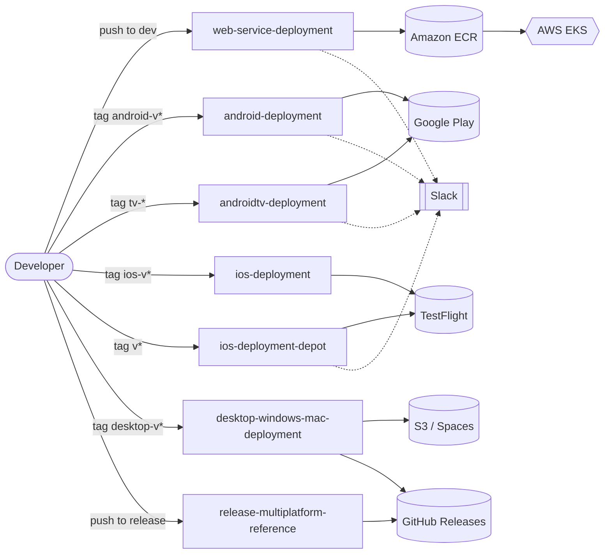
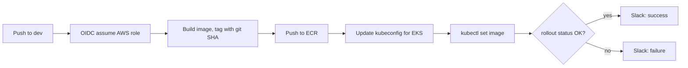
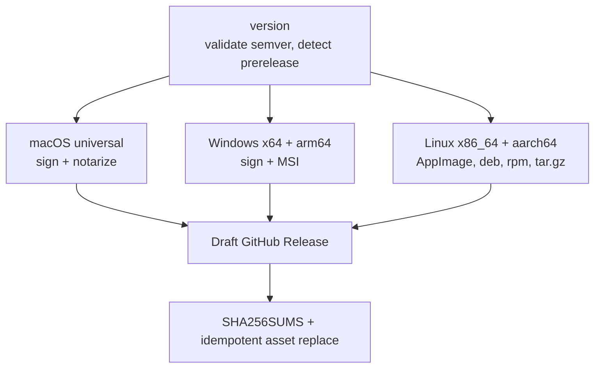

# CI/CD Pipelines — Chess Prime

**Production-grade GitHub Actions workflows for backend delivery to AWS EKS and multi-platform app releases (Android, Android TV, iOS, macOS, Windows, Linux).**

---

## Table of Contents

1. [Overview](#overview)
2. [Architecture at a Glance](#architecture-at-a-glance)
3. [Repository Structure](#repository-structure)
4. [Trigger and Runner Matrix](#trigger-and-runner-matrix)
5. [Workflow Deep Dives](#workflow-deep-dives)
6. [Secrets and Variables Matrix](#secrets-and-variables-matrix)
7. [Security Model](#security-model)
8. [Engineering Practices](#engineering-practices)
9. [Cost Optimization](#cost-optimization)
10. [Troubleshooting Playbook](#troubleshooting-playbook)
11. [Adopting a Workflow](#adopting-a-workflow)
12. [Conventions](#conventions)
13. [Roadmap](#roadmap)

---

## Overview

This repository holds the CI/CD pipeline definitions used to build, sign, and release the Chess Prime platform across every supported surface. It doubles as a hands-on learning repo for DevOps, MLOps, and cloud practice.

Each workflow is written for real operational use:

- Secrets are validated **before** expensive steps run.
- Signing material is handled securely and **always** cleaned up.
- Every pipeline surfaces success or failure through Slack.
- Every design choice accounts for build cost and runner efficiency.

Pipelines are organized **by deployment target**, so each file reads end to end as one complete release process, from source checkout to store submission or production rollout.

> **Note:** `release-multiplatform-reference.yml` is a **reference pattern**, not a runnable pipeline. Its `packaging/*` scripts are placeholders by design. See [its deep dive](#6-release-multiplatform-referenceyml-reference-only).

---

## Architecture at a Glance

---

## Repository Structure

| File | Deployment Target | Description |
|---|---|---|
| `web-service-deployment.yml` | AWS EKS (`ap-south-1`) | Builds and pushes a Docker image to ECR using OIDC role assumption, deploys via `kubectl set image`, verifies rollout status, and reports build status to Slack. |
| `android-deployment.yml` | Google Play | Builds a signed Android App Bundle and APK with Gradle on a Depot-hosted runner, then publishes to the Google Play internal testing track. |
| `androidtv-deployment.yml` | Google Play | Generates the Gradle wrapper, applies dependency caching, builds and signs the Android TV release, generates build checksums, publishes to Google Play, and reports status to Slack. |
| `ios-deployment.yml` | TestFlight | Archives and exports the native iOS app using manual code signing on a self-hosted macOS runner, then uploads to TestFlight. |
| `ios-deployment-depot.yml` | TestFlight | Builds the Expo/React Native iOS app on a Depot-hosted macOS runner, installs CocoaPods with retry handling, uploads to TestFlight, and posts the IPA to Slack with a threaded build summary. |
| `desktop-windows-mac-deployment.yml` | S3 / DigitalOcean Spaces + GitHub Releases | Multi-job pipeline: derives release metadata from the git tag, validates Apple signing credentials, builds and notarizes a universal macOS binary, builds a signed Windows installer, generates checksums, produces an Ed25519-signed update manifest, and publishes all artifacts. |
| `release-multiplatform-reference.yml` | GitHub Releases (draft) | **Reference only.** Multi-platform release pattern (macOS, Windows, Linux) that builds, signs, checksums, and creates or updates a draft GitHub Release with environment-scoped secrets and SHA-pinned actions. |

---

## Trigger and Runner Matrix

| Workflow | Trigger | Runner | Timeout |
|---|---|---|---|
| `web-service-deployment` | push to `dev` (path-filtered) or manual | `ubuntu-22.04` | 15 min |
| `android-deployment` | tag `android-v*` or manual | `depot-ubuntu-22.04-8` | 45 min |
| `androidtv-deployment` | tag `tv-*` or manual | `depot-ubuntu-22.04-16` | 30 min |
| `ios-deployment` | tag `ios-v*` or manual | self-hosted `macos-inhouse` | 60 min |
| `ios-deployment-depot` | tag `v*` or manual | `depot-macos-15` | 45 min |
| `desktop-windows-mac-deployment` | tag `desktop-v*` or manual | self-hosted macOS, `depot-windows-2025-4`, `ubuntu-latest` | 25 min per build job |
| `release-multiplatform-reference` | push to `release` or manual | `macos-15`, `windows-latest`, `ubuntu-22.04` (+ ARM) | per job |

**Why tags instead of branch pushes?** Mobile and desktop builds are the most expensive jobs here. Tag-gating means a normal commit never burns macOS or large-runner minutes.

---

## Workflow Deep Dives

### 1. `web-service-deployment.yml`

- **Auth:** short-lived OIDC credentials, no stored AWS keys.
- **Tagging:** immutable git-SHA tag plus a moving `latest`.
- **Verification:** `kubectl rollout status` confirms pods are actually healthy, not just that the manifest applied.
- **Path filter:** only service, workflow, and lockfile changes trigger a deploy.

### 2. `android-deployment.yml`

Validates deploy configuration, decodes the keystore, builds a signed AAB and APK (`assembleRelease bundleRelease`), uploads both as artifacts, and publishes the bundle to the **internal** Play track.

### 3. `androidtv-deployment.yml`

Same shape as Android with extras: Gradle wrapper generation, `actions/cache` for Gradle, up-front secret validation, SHA-256 checksums, a **keystore wipe (`if: always()`)**, and Slack success/failure notifications. The Play upload uses `continue-on-error` because re-uploading an existing version code is an expected, non-fatal failure.

### 4. `ios-deployment.yml` (self-hosted)

Native Xcode project with **three provisioning profiles** (app, broadcast extension, share extension). Installs each profile by UUID, archives, exports an IPA via a generated `ExportOptions.plist`, and uploads to TestFlight. Runs on an in-house macOS runner to avoid hosted macOS minute costs.

### 5. `ios-deployment-depot.yml` (Expo / React Native)

Expo prebuild, then a CocoaPods install wrapped in **bounded retry with linear backoff** (GitHub's CDN intermittently returns 5xx for prebuilt xcframeworks). Optional Sentry source-map upload that **degrades gracefully** when the token is absent or Sentry is down. Posts the IPA and a threaded summary to Slack via the Bot API upload flow.

### 6. `release-multiplatform-reference.yml` (reference only)

A **pattern study** for shipping one app to macOS, Windows, and Linux from a single `release` branch, ending in a draft GitHub Release.

Patterns worth studying:

| Pattern | What it does | Why it matters |
|---|---|---|
| **Environment-scoped secrets** | Only signing jobs and the release job declare `environment: release` (restricted to the `release` branch) | A dry run on any branch cannot read signing secrets |
| **Secret-free jobs** | Linux and version jobs have no environment | Least privilege; safe to dispatch anywhere |
| **Optional secrets** | Missing signing secrets yield unsigned artifacts, not failed builds | Forks and test runs still work |
| **`cancel-in-progress: false`** | A newer push waits instead of killing a run mid-notarization | Prevents half-uploaded releases |
| **Semver gate** | Regex validates the version and derives `prerelease` from a `-rc.1` style suffix | Bad versions fail in seconds |
| **Oldest-OS Linux build** | Builds on `ubuntu-22.04` | Binary only needs glibc >= 2.35, so it runs on older distros |
| **Idempotent draft release** | Existing draft: delete assets, edit, re-upload. Published: hard fail | Re-runs are safe; shipped releases are immutable |
| **SHA-pinned actions** | `uses: owner/action@<commit-sha> # vX.Y.Z` | Tags can be moved by an attacker; commit SHAs cannot |

> `packaging/macos/package.sh`, `packaging/windows/package.ps1`, and `packaging/linux/package.sh` are intentionally **not implemented**. This file is a reference and will fail if run as-is.

### 7. `desktop-windows-mac-deployment.yml`

Jobs run in order: `prepare` (tag to version/channel) → `preflight` (certificate import, signing identity, API key format) → `build-macos` / `build-windows` in parallel → `publish`. Publishing generates `SHA256SUMS`, builds `latest.json`, **signs it with Ed25519**, uploads to object storage, and creates a draft GitHub Release. Only the `release` channel publishes the update manifest.

---

## Secrets and Variables Matrix

| Workflow | Secrets / Variables |
|---|---|
| `web-service-deployment` | `AWS_DEPLOY_ROLE_ARN`, `SLACK_WEBHOOK_URL` |
| `android-deployment` | `KEYSTORE_BASE64`, `KEYSTORE_PASSWORD`, `KEY_ALIAS`, `KEY_PASSWORD`, `GOOGLE_PLAY_SERVICE_ACCOUNT_JSON`, Maps API key, API base URL variables |
| `androidtv-deployment` | `ANDROIDTV_KEYSTORE_BASE64`, `ANDROIDTV_KEYSTORE_PASSWORD`, `ANDROIDTV_KEY_ALIAS`, `ANDROIDTV_KEY_PASSWORD`, `GOOGLE_PLAY_SERVICE_ACCOUNT_JSON`, `SLACK_WEBHOOK_URL` |
| `ios-deployment` | `APPLE_CERTIFICATE_BASE64`, `APPLE_CERTIFICATE_PASSWORD`, three provisioning profile secrets, App Store Connect issuer/key ID/API key, `APPLE_DEVELOPMENT_TEAM` |
| `ios-deployment-depot` | Apple certificate and profile secrets, `GOOGLE_SERVICE_INFO_PLIST`, App Store Connect credentials, `SENTRY_AUTH_TOKEN` (optional), `SLACK_BOT_TOKEN`, `SLACK_CHANNEL_ID` |
| `desktop-windows-mac-deployment` | Desktop Apple certificate and password, Apple team and API key set, Spaces credentials (key, secret, region, bucket, endpoint, CDN URL), `MANIFEST_ED25519_PRIVATE_KEY` |
| `release-multiplatform-reference` | Optional: Apple signing set, Windows certificate or Azure Trusted Signing set. `GITHUB_TOKEN` for the release job |

Store signing secrets in **GitHub Environments** where possible so branch rules gate access.

---

## Security Model

| Control | Implementation |
|---|---|
| **No long-lived cloud keys** | AWS access via OIDC role assumption |
| **Least-privilege tokens** | Workflow default `contents: read`; `write` only on the release job |
| **Environment isolation** | Signing secrets live in a protected `release` environment |
| **Ephemeral signing material** | Keystores, `.p12` files, provisioning profiles, and temporary keychains deleted in `if: always()` steps |
| **Supply-chain pinning** | Third-party actions pinned to commit SHAs in the reference pipeline |
| **Signed update manifests** | Ed25519 signature on `latest.json` so clients can verify updates |
| **Integrity evidence** | `SHA256SUMS` published beside every artifact set |
| **Injection hygiene** | Secrets passed through `env:`, not interpolated into shell scripts |
| **Fail fast on bad config** | Up-front validation of secrets, key formats, and version strings |

---

## Engineering Practices

- **Validate first, build second.** Missing secrets fail in seconds, not after a 20-minute compile.
- **Bounded retries on known flakiness.** CocoaPods installs and WebRTC prebuilt downloads retry with limits so transient network errors do not break a release.
- **Graceful degradation for optional integrations.** Sentry upload is skipped when unconfigured and tolerated when the service is down.
- **Traceability.** Versioned artifacts, checksums, and run links in every notification.
- **Right tool per runner.** GitHub-hosted, Depot-hosted, and self-hosted runners are chosen per workload.
- **Concurrency control.** Release pipelines queue instead of cancelling in-flight signing or uploads.
- **Visibility.** Slack webhook (simple pass/fail) and Slack Bot API (file upload plus threaded notes).

---

## Cost Optimization

| Lever | Detail |
|---|---|
| **Tag-gated heavy builds** | Mobile and desktop jobs never run on ordinary pushes |
| **Caching** | Gradle, Cargo, and `sccache` keyed on lockfile hashes cut repeat download and compile time |
| **Runner right-sizing** | Do not default to the largest tier; benchmark before upsizing (for example, `-16` vs `-8` for Android TV) |
| **Self-hosted macOS** | Avoids high-multiplier hosted macOS minutes for frequent iOS builds |
| **OIDC** | Removes the operational cost of rotating and auditing static AWS keys |
| **Registry lifecycle policies** | Expire untagged ECR images so storage does not grow unbounded |
| **Scoped `continue-on-error`** | Only on genuinely non-fatal steps, never on validation or security |
| **Prebuilt tool installs** | Prefer cached or prebuilt binaries over compiling CLIs from source each run |

**Rule of thumb:** macOS and Windows minutes bill at a higher multiplier than Linux. Keep them tag-gated and minimal.

---

## Troubleshooting Playbook

| Symptom | Likely Cause | Fix |
|---|---|---|
| `Missing secret ...` at the start | Secret not set in repo or environment | Add it, or confirm the job's `environment:` name |
| Play upload fails with version conflict | Version code already exists | Bump `versionCode`; the step is `continue-on-error` by design |
| TestFlight upload skipped | Build number or version already exists | Increment the build number |
| `pod install` fails with 5xx | GitHub CDN hiccup on a prebuilt xcframework | Built-in retry handles it; re-run if all attempts fail |
| WebRTC download fails in Rust build | Transient network error in `build.rs` | Retry wrapper covers it; re-run if persistent |
| Notarization auth error | API key not a valid `.p8` | Check the `BEGIN PRIVATE KEY` header and the key ID |
| `No Developer ID Application identity found` | Wrong certificate type in the secret | Export a Developer ID Application certificate |
| iOS SDK missing on runner | Xcode platform not downloaded | The setup step retries `-downloadPlatform iOS` |
| Draft release step errors with "already published" | Version was shipped earlier | Bump the version before pushing to `release` |
| Slack message not delivered | Wrong webhook or bot scope | Verify the secret and the bot's `chat:write` and `files:write` scopes |

---

## Adopting a Workflow

1. Copy the workflow into `.github/workflows/` in the target repository.
2. Replace placeholder secrets, variables, package or bundle identifiers, cluster names, and regions.
3. Create the required **GitHub Environments** and add secrets there where noted.
4. Run once with `workflow_dispatch` on a non-production target.
5. Read the inline comments before changing retry, validation, or cleanup logic. Each exists because of a specific failure mode.

---

## Conventions

- **Naming:** `<surface>-deployment.yml`, with a `-depot` or `-self-hosted` suffix only when two variants coexist.
- **Tags:** `android-v*`, `tv-*`, `ios-v*`, `desktop-v*`, `v*` per surface.
- **Pinning:** third-party actions pinned to full commit SHAs with a version comment (reference pipeline today; migrate the rest).
- **Comments:** explain *why* a step exists, not what the YAML already says.
- **Permissions:** declare `permissions:` explicitly at workflow or job level.

---

## Roadmap

**Delivery**
- [ ] Migrate EKS deploys from `kubectl set image` to Helm releases
- [ ] ArgoCD GitOps with ApplicationSets and automated image updates
- [ ] Canary or blue-green rollouts with Argo Rollouts

**Infrastructure and Policy**
- [ ] Terraform pipeline: plan on PR, apply on merge, remote state in S3 with locking
- [ ] Policy-as-code (OPA Gatekeeper / Kyverno) with admission-level verification of signed images
- [ ] Vault on EKS for centralized secrets management

**Observability and Cost**
- [ ] Prometheus and Grafana stack for the EKS cluster
- [ ] Kubecost or OpenCost for cost visibility

**Pipeline Hygiene**
- [ ] Consolidate the two iOS workflows into one Fastlane-driven pipeline
- [ ] Pin every third-party action to a commit SHA and automate bumps with Dependabot
- [ ] Extract repeated setup steps into composite actions or reusable workflows
- [ ] Benchmark runner sizes and record build-time versus cost per workflow

---

Built while learning DevOps, MLOps, and Cloud, one real pipeline at a time.

